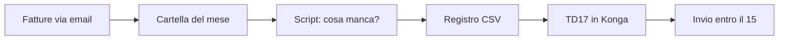

# ⭐ Fornitori esteri e documenti TD17

> Aggiornato al 15/10/2026 · **Priorità n. 1 del titolare**
> Fonti: [NT+ Fisco – servizi POS da società irlandese: TD17 dovuto](https://ntplusfisco.ilsole24ore.com/art/la-societa-irlandese-che-offre-servizi-pos-e-esonerata-dall-integrazione-ma-e-tenuta-all-invio-file-td17-AEUmmg3B) · [Studio Pizzano – fatture Stripe dall'Irlanda](https://www.studiopizzano.it/fatture-stripe-dallirlanda-nuovo-regime-fiscale-per-i-forfettari/) · [EC News – PayPal e adempimenti](https://www.ecnews.it/fiscale/fisco-e-patrimonio/iva/paypal-semplifica-i-pagamenti-ma-non-gli-adempimenti-fiscali/)

## Il problema
I fornitori esteri non mandano fatture via SDI. Per **ogni fattura** ricevuta va trasmesso allo SDI un documento integrativo **TD17**, entro il **15 del mese successivo** (al ricevimento per i fornitori UE, all'operazione per quelli extra-UE).

## I fornitori di Volta la Carta

| Fornitore (sede tipica, ⚠️ verificare in fattura) | Servizio | Trattamento prevalente | Documento |
|---|---|---|---|
| Meta Platforms Ireland | Pubblicità | Reverse charge, IVA 22% a debito e a credito | TD17 |
| Google Ireland | Pubblicità | idem | TD17 |
| Adobe Systems Software Ireland | Software | idem | TD17 |
| Canva (Australia, extra-UE) | Software | Autofattura con IVA 22% | TD17 |
| Stripe Payments Europe (Irlanda) | Pagamenti, **esente** | Nessuna IVA da integrare, documento comunque dovuto | TD17 natura N4 |

Con 5 fornitori in abbonamento mensile sono circa **60 documenti l'anno**. ❓ Conferma del trattamento: [domande 8 e 17](domande-commercialista.md).

## Come semplificare
1. **Partita IVA** inserita in Meta Business, Google Ads, Adobe, Canva: senza, alcuni addebitano l'IVA italiana come a un privato e quell'IVA non si recupera correttamente.
2. **Meno fornitori esteri**: niente PayPal o altri strumenti esteri non necessari.
3. **Abbonamenti annuali** invece che mensili dove possibile: 1 documento invece di 12.
4. **Invio automatico** delle fatture via email a un unico indirizzo; salvataggio in `Fornitori esteri/AAAA-MM/fornitore_AAAA-MM-GG.pdf`.
5. **Controllo automatico** di cosa manca: [script/controlla_fornitori_esteri.py](../script/controlla_fornitori_esteri.py).
6. In Konga i TD17 si fanno con "Causale/Cliente Registrazioni Integrative" e "Tipologia Documento Integrazione Beni/Servizi", e si inviano con Legal Solution.
7. ❓ Chiedere al commercialista se preferisce occuparsene lui partendo dal report mensile.

## Ciclo del mese

Registro (`registro-fornitori-esteri.csv`): `mese; fornitore; paese; data_fattura; numero_fattura; imponibile; tipo (22% / N4); td17_inviato; data_invio`.
Più fatture dello stesso fornitore nel mese (Google Ads lo fa spesso) = un TD17 per ciascuna.
