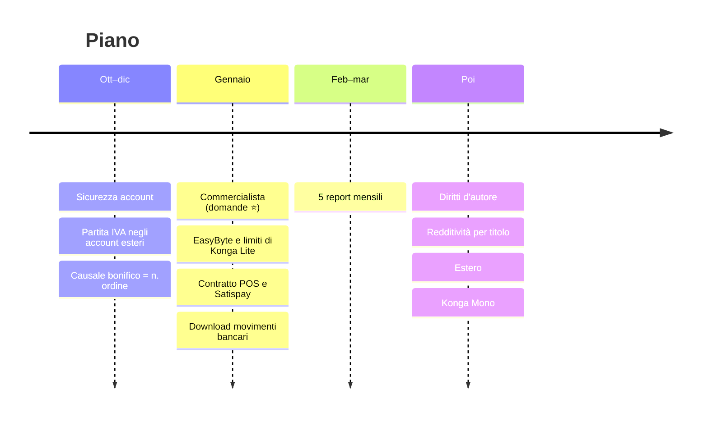

# Roadmap

> Aggiornata al 16/10/2026 · Scelte del titolare: **solo report**, senza fretta, accessi solo al titolare.
> Ottobre–dicembre è il picco delle tesi: ora solo cose da pochi minuti, il resto da **gennaio**.

## Subito (ottobre–dicembre)
- [ ] **Verifica in due passaggi** su banca, Stripe, email, Google/Meta, Konga/intermediario → [sicurezza](sicurezza.md)
- [ ] **Niente password condivise**: un gestore di password, un accesso per persona.
- [ ] **Partita IVA** negli account Meta, Google, Adobe, Canva.
- [ ] **Invio automatico** delle fatture di questi fornitori a un unico indirizzo.
- [ ] Sul sito: **causale del bonifico = numero d'ordine**, in evidenza nell'email di conferma.

## Gennaio — fondamenta
- [ ] Incontro con il commercialista: [domande ⭐](../03-fisco/domande-commercialista.md)
- [ ] EasyByte: limiti di Lite; contare articoli e anagrafiche → [konga](../04-konga/konga.md)
- [ ] Contratto del POS della banca; valutare Satispay → [negozio](../02-incassi/negozio-laboratorio.md)
- [ ] Attivare il **download mensile dei movimenti** in CSV/Excel.
- [ ] In Konga: conto transitorio Stripe e codici IVA concordati.

## Febbraio–marzo — i report
Un file al mese per report; le registrazioni restano manuali.

| # | Report | A cosa serve | Fonte | Script |
|---|---|---|---|---|
| 1 | ⭐ Fornitori esteri del mese | TD17 entro il 15 | Fatture via email + Stripe | [controlla_fornitori_esteri.py](../script/controlla_fornitori_esteri.py) |
| 2 | Vendite online per aliquota | Corrispettivi mensili | WooCommerce + Stripe | da scrivere |
| 3 | Payout Stripe con dettaglio ordini | Abbinamento in banca | API Stripe | [export_stripe.py](../script/export_stripe.py) |
| 4 | Bonifici da abbinare (anche all'imponibile PA) | Riconciliazione | CSV banca + partite aperte Konga | da scrivere |
| 5 | Fatture PA: stato SDI e scadenze | Solleciti | Konga | da scrivere |

## Più avanti, se serve
- Diritti d'autore da Excel a un report per ISBN.
- Redditività per titolo e per servizio (centri di costo).
- Vendite all'estero: PayPal, OSS, Stripe Tax.
- Passaggio a Konga Mono.

## Non previsto (per scelta)
Scrittura automatica in Konga, webhook, job notturni: documentati in [06-automazione](../06-automazione/architettura.md) come riferimento.
