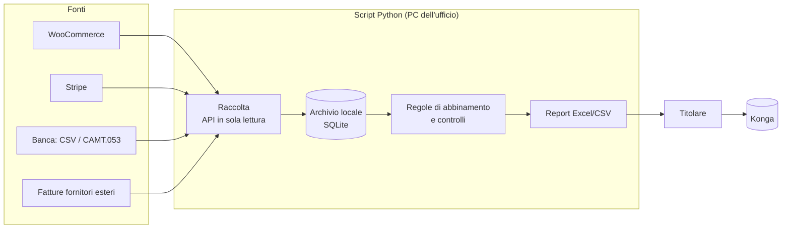

# Automazione — principi e architettura (riferimento)

> Oggi il titolare vuole **solo report** ([roadmap](../05-operativo/roadmap.md)). Questo file descrive come andare oltre, se un giorno servisse.

## Sette principi
1. **Konga è la fonte di verità contabile**; strumenti di pagamento e sito sono fonti di dati.
2. **Prima leggere, poi scrivere**: settimane di report confrontati con il lavoro manuale prima di qualsiasi scrittura in Konga.
3. **Umano nel ciclo** per tutto ciò che va all'Agenzia: fatture lasciate in `Sospeso` e confermate a mano.
4. **Idempotenza**: rieseguire uno script non duplica nulla (ogni oggetto ha un riferimento esterno, es. `stripe:ch_…`, `payout:po_…`).
5. **La riconciliazione è il test**: saldo transitorio in Konga = saldo Stripe; commissioni registrate = documento Stripe. Se non torna, ci si ferma.
6. **Minimo privilegio**: chiavi in sola lettura, utente Konga dedicato, segreti fuori dal codice.
7. **Tutto tracciato**: log di ogni esecuzione + Giornale delle Attività di Konga.

## Architettura

| Componente | Cosa fa | Tecnologia |
|---|---|---|
| Raccolta | Scarica transazioni, commissioni, payout, rimborsi; legge estratti e cartelle | Python, libreria `stripe` |
| Archivio locale | Dati grezzi + stato di cosa è già registrato | SQLite |
| Regole | Abbina payout ↔ ordini ↔ movimenti banca; controlla saldi | Python |
| Report | Un file al mese, con avvisi se qualcosa non torna | CSV/Excel |
| Webhook (facoltativo) | Avvisi immediati (contestazioni, rimborsi); non tocca mai Konga | [script/stripe_webhook.py](../script/stripe_webhook.py) |

## Abbinamenti
- **Payout Stripe**: somma delle transazioni del payout = importo; movimento in banca con stesso importo, data ± 3 giorni lavorativi, descrizione con `STRIPE`.
- **Bonifici dei clienti**, in ordine di affidabilità: numero di fattura in causale + importo uguale al residuo → importo esatto e unico tra le partite aperte del cliente → coda "da abbinare a mano". Per la PA: confrontare con l'**imponibile**.

## Se un giorno si scrivesse in Konga
Prima file CSV/JSON da importare a mano, poi eventualmente kongalib (richiede un server Konga). Sempre: utente dedicato, backup prima dell'import, una transazione per import, riferimento esterno nella descrizione, mai toccare registrazioni non create dallo script. Esempio: [script/prepara_prima_nota.py](../script/prepara_prima_nota.py).
