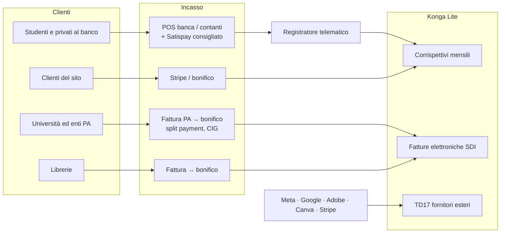

# Incassi, fisco e Konga

[← vlc-supporto](../README.md)

Base di conoscenza di **Volta la Carta** (Ferrara) su come si incassa, cosa chiede il fisco e come si lavora con Konga, con un piano per ridurre il lavoro manuale.

**Aggiornato al:** 21/11/2026 (contenuti verificati il 15–16/10/2026) · [Changelog](CHANGELOG.md)

> Raccolta e schematizzata da Claude a partire dal lavoro fatto in chat tra il 15 e il 16 ottobre 2026.
> Temi vicini in questo repository: vendita online e obblighi di legge in [ecommerce-normativa/](../ecommerce-normativa/README.md) (cookie, recesso, condizioni di vendita, pagamenti sul sito); strategia e MePA in [strategia/](../strategia/README.md).
> Le parti fiscali sono una sintesi di fonti pubbliche: **non sostituiscono il commercialista**.
> Marcatori: ⚠️ = da verificare · ❓ = domanda aperta · ⭐ = priorità.

## Il quadro in una pagina

| | |
|---|---|
| **Chi** | Ditta individuale di Claudio Fabbri, contabilità ordinaria, IVA mensile, Ferrara (area ZLS), attiva da più di 10 anni, 1–2 persone |
| **Due attività** | ① Casa editrice (100–250 titoli, tutti con ISBN, nessun distributore, poche librerie) · ② Laboratorio-negozio di stampa, rilegatura (tesi) e cartoleria, aperto al pubblico |
| **Clienti principali** | Università ed enti pubblici (MePA), studenti al banco, sito WooCommerce, poche librerie |
| **Incassi oggi** | POS della banca + contanti al banco · fattura → bonifico per enti e librerie · Stripe (appena aperto) e bonifico sul sito |
| **Gestionale** | Konga **Lite** (Contabilità, Vendite, Legal Solution), fatture elettroniche via Konga |
| **Cosa pesa di più** | ⭐ Gli adempimenti mensili per i **fornitori esteri** (Meta, Google, Adobe, Canva, Stripe) |
| **Automazione voluta** | **Solo report**: le registrazioni le fa il titolare |
| **Tempi** | Senza fretta; ottobre–dicembre è il picco delle tesi → il lavoro vero parte a **gennaio** |

## Schema

## Decisioni e raccomandazioni

| Tema | Scelta | Dove |
|---|---|---|
| Sito | **Stripe** come pagamento principale, bonifico come alternativa con causale = numero d'ordine | [02-incassi/strategia](02-incassi/strategia.md) |
| PayPal | **Non aprirlo per ora**: costa il doppio e aggiunge un fornitore estero | [02-incassi/strategia](02-incassi/strategia.md) |
| Banco | Tenere il POS della banca (verificarne il costo) e **aggiungere Satispay** per gli importi sotto i 10 € | [02-incassi/negozio-laboratorio](02-incassi/negozio-laboratorio.md) |
| PA | Fattura PA con CIG e codice ufficio; si incassa solo l'imponibile (split payment fino al 30/06/2029) | [02-incassi/pa-mepa](02-incassi/pa-mepa.md) |
| Fornitori esteri | Partita IVA in tutti gli account, fatture in una cartella al mese, controllo automatico di cosa manca, TD17 entro il 15 | [03-fisco/fornitori-esteri-td17](03-fisco/fornitori-esteri-td17.md) |
| Konga | Lite è vicino ai limiti (250 articoli, 250 anagrafiche): contarli e valutare Mono | [04-konga/konga](04-konga/konga.md) |
| Automazione | 5 report mensili, nessuna scrittura automatica in Konga | [05-operativo/roadmap](05-operativo/roadmap.md) |

## Prossimi passi

1. **Subito (1–2 ore)**: verifica in due passaggi ovunque, basta password condivise, partita IVA negli account esteri → [roadmap](05-operativo/roadmap.md#subito-ottobredicembre)
2. **Gennaio**: incontro con il commercialista con le domande ⭐ → [domande](03-fisco/domande-commercialista.md)
3. **Febbraio–marzo**: i 5 report mensili → [roadmap](05-operativo/roadmap.md#febbraiomarzo--i-report)

## Indice

| Cartella | Contenuto |
|---|---|
| [01-profilo/](01-profilo/) | Profilo dell'attività, risposte del titolare, punti chiariti |
| [02-incassi/](02-incassi/) | Strategia, commissioni a confronto, schede degli strumenti, negozio, PA |
| [03-fisco/](03-fisco/) | IVA sui libri, corrispettivi, fornitori esteri (TD17), fattura elettronica, estero, domande al commercialista |
| [04-konga/](04-konga/) | Edizioni e limiti, fatture elettroniche, piano dei conti, libreria Python |
| [05-operativo/](05-operativo/) | Roadmap, chiusura mensile, scadenzario, sicurezza |
| [06-automazione/](06-automazione/) | Principi e architettura (riferimento per il futuro) |
| [script/](script/) | Script Python pronti: export Stripe/PayPal, controllo fornitori esteri, calcolatore commissioni, webhook |
| [strumenti/](strumenti/) | Questionario del titolare (HTML offline) e testo dell'email per inviarlo |
| [dati/](dati/) | Risposte del titolare in CSV |
| [glossario.md](glossario.md) · [fonti.md](fonti.md) · [CHANGELOG.md](CHANGELOG.md) | |

## Come aggiornarlo
- I **numeri che cambiano** (commissioni, soglie, scadenze) stanno solo in [02-incassi/commissioni](02-incassi/commissioni.md) e [05-operativo/scadenzario](05-operativo/scadenzario.md).
- Commissioni: riverifica ogni 6 mesi. Regole fiscali: ogni gennaio.
- Quando il commercialista risponde: scrivere la risposta in [domande-commercialista](03-fisco/domande-commercialista.md) con la data e aggiornare il file collegato.
- Ogni modifica: una riga in [CHANGELOG.md](CHANGELOG.md).
