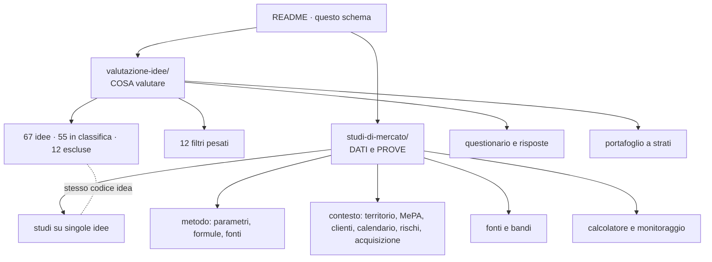

# Strategia di sviluppo

[← vlc-supporto](../README.md)

Il materiale strategico per scegliere e far crescere le nuove linee di attività: **valutazione delle idee** e **studi di mercato**. Ferrara → Emilia-Romagna e Veneto → Italia → UE.

*Contenuti al 16/10/2026 · registro bandi aggiornato al 15/11/2026.* Quasi tutte le cifre sono **stime** (livello di prova 0–1): servono per confrontare le idee, non per decidere senza un test. Norme e bandi vanno ricontrollati: ogni file riporta la data di consultazione.

---

## Mappa



| Cartella | Serve a | Da dove partire |
|---|---|---|
| [valutazione-idee/](valutazione-idee/00-indice.md) | Decidere **cosa** approfondire: schede, voti, classifica, sinergie | [02-classifica](valutazione-idee/02-classifica.md), [05-elenco-proposte](valutazione-idee/05-elenco-proposte.md) |
| [studi-di-mercato/](studi-di-mercato/00-indice.md) | Verificare **se regge**: dati, fonti, prove, numeri | [00-indice](studi-di-mercato/00-indice.md) |

Ogni idea ha lo stesso codice nelle due cartelle (es. `NEW-05`).

**Famiglie di idee:** UNI università · DOC documentazione B2B · EDI editoria · ACC accessibilità · GIO giochi e carte · CAR carte pregiate · SER servizi · EXP export · NEW combinazioni.

---

## 1. Profilo (dal questionario del 15/10)

| Tema | Risposta |
|---|---|
| Dimensione | Ditta individuale, 1–2 persone, fatturato sotto 100.000 €, in utile, attiva da oltre 10 anni |
| Budget per le idee nuove | **Sotto 10.000 €**, solo mezzi propri, nessun bando ottenuto né seguito |
| Tesi | 500–1.500 l'anno, 25–50% del fatturato |
| Mesi pieni | **Marzo, luglio, ottobre** · agosto: 2 settimane chiuso · gli altri mesi hanno spazio |
| Macchine | Brossura, stampa a caldo, taglierina, cordonatrice, punto metallico, spiralatrice; colore SRA3 quasi fotografico; 250–350 g; meno di 3 anni |
| Carta | 2–3 fornitori di carte pregiate · niente fondi di magazzino · niente rivendita al foglio |
| Casa editrice | 100–250 titoli; contratti **senza** diritti digitali, audio e AI; nessun EPUB prodotto; no ISBN per collane di terzi |
| Clienti già attivi | Università, enti di formazione, aziende, studi professionali, comuni, musei e fondazioni (non scuole e associazioni) |
| Canali | Sito WooCommerce (il principale), **MePA già attivo**, meno di 5 bookshop, nessuna lista email |
| Preferenze | Aziende ed enti · progetti sempre diversi · contatti diretti accettati, anche visite |

Dettaglio: [06-risposte-e-ricalibrazione](valutazione-idee/06-risposte-e-ricalibrazione.md).

---

## 2. Metodo in breve

- **12 filtri** con peso: P12 profitto in 12 mesi ×3 · SCA scala ×2,5 · SFO sforzo ×2,5 · INT interesse del titolare ×2,5 · INV investimento ×2 · ASS asset esistenti ×2 · RIC ricorrenza ×2 · DUR durata ×2 · ESP espandibilità ×1,5 · PIC conflitto con i picchi tesi ×1,5 · FAC niente faccia ×1 · RIS rischio ×1.
- **Fasce:** S ≥ 80 · A 75–79,9 · B 68–74,9 · C < 68.
- **Studio di mercato:** 13 blocchi di parametri (A–M), fonti di rango 1–8, livello di prova 0–4, indice di confidenza, TAM/SAM/SOM, margine, break-even, payback, LTV/CAC, tre scenari.
- **Regola P12:** voto alto solo se payback ≤ 6 mesi **e** utile netto anno 1 ≥ 10.000 € nello scenario base; massimo 3 se lo scenario pessimista è in perdita.
- **Regola dei 2.000 €:** niente investimenti oltre 2.000 € con confidenza sotto 2; prima un test da massimo 500 €.

File: [01-metodo-e-filtri](valutazione-idee/01-metodo-e-filtri.md) · [griglia](studi-di-mercato/00-metodo/01-griglia-parametri.md) · [formule](studi-di-mercato/00-metodo/02-formule-e-soglie.md) · [fonti e prove](studi-di-mercato/00-metodo/03-gerarchia-fonti-e-prove.md).

---

## 3. Classifica v3 (in cima)

| # | Codice | Idea | Punti | In una riga |
|---|---|---|---|---|
| 1 | NEW-04 | Vendere alla PA tramite MePA | 88,5 | Già abilitati: riempire il catalogo |
| 2 | DOC-02 | Manuali per enti di formazione | 83,8 | Clienti già vostri, riordino a ogni corso |
| 3 | DOC-08 | Notiziari di associazioni, ordini, parrocchie | 83,8 | Quasi un abbonamento |
| 4 | DOC-07 | Diari d'istituto | 83,4 | Produzione d'estate, vendita gen–apr |
| 5 | DOC-01 | Manuali di conformità | 82,6 | Regolamento Macchine da gennaio 2027 |
| 6 | ACC-03 | E-book accessibili | 82,6 | Domanda più piccola: micro-imprese esenti |
| 7 | NEW-06 | Autopubblicazione con marchio separato | 81,3 | Mestiere editoriale venduto come servizio |
| 8 | NEW-01 | Stampa su richiesta | 81,3 | Spazio vero: associazioni, enti, urgenze, pregio |
| 9 | DOC-05 | Diplomi e attestati di pregio | 80,9 | Clienti già vostri, nov–dic liberi |
| 10 | UNI-02 | Agende accademiche con sponsor | 80,4 | Stampa ad agosto |
| 11 | DOC-06 | Quaderni di laboratorio numerati | 80,4 | Margine alto, pochi euro assoluti |

Fascia A (75–79,9): DOC-10, NEW-02, CAR-11, CAR-04, UNI-01, DOC-09, SER-03, DOC-11, SER-09, SER-10, EDI-09.

**Escluse dopo il questionario (12):** CAR-01, CAR-02, CAR-03, CAR-06, CAR-07, CAR-10, EDI-07, NEW-07, NEW-10, SER-04, SER-05, SER-06.

Classifica completa: [02-classifica](valutazione-idee/02-classifica.md) · dati grezzi: [punteggi.csv](valutazione-idee/punteggi.csv).

**Voti proposti dagli studi, non ancora applicati:** CAR-04 DUR 4→3 · NEW-05 SFO 3→4 e RIC 3→4 · ACC-03 SCA da rivedere.

---

## 4. Portafoglio a strati

Nessuna idea basta da sola: il risultato arriva sommando 4–6 idee che condividono lo stesso **motore**.

| Motore comune | Idee che lo riusano |
|---|---|
| ⚙️ Motore documenti (NEW-02) | DOC-01, 02, 05, 07, 08, 10 · ACC-03 · EDI-09 · NEW-06 · UNI-01 |
| 🎙️ Raccolta contenuti da persone | SER-09, SER-10, DOC-11, SER-03 |
| 🖨️ Stampa conto terzi (NEW-01) | CAR-04, CAR-11, EDI-09, NEW-06, NEW-09 |
| 📜 Carte pregiate | CAR-04, CAR-11, NEW-05, DOC-05 |
| 🏛️ Canale MePA (NEW-04) | DOC-05, DOC-06, DOC-07, ACC-01 |

| Strato | Idee | Quando | Investimento |
|---|---|---|---|
| 0 · Canale pronto | NEW-04 catalogo MePA | subito | ≈ 0 |
| 1 · Clienti che avete già | DOC-02, DOC-05 | ott–dic 2026 | 1.000–2.500 € |
| 2 · Contratti annuali | DOC-08, DOC-07 | gen–apr 2027 | 1.500–4.000 € |
| 3 · Servizi senza macchine | DOC-01, ACC-03, NEW-06 | da feb 2027, uno alla volta | 1.000–4.000 € |
| 4 · Riempire agosto | UNI-02, NEW-01 | primavera–estate 2027 | 0–3.000 € |
| Più avanti | NEW-02 leggero → UNI-01 | dal 2028 | fuori budget |

Gli strati partono **uno dopo l'altro**, ognuno pagato da quello prima e fermato se non supera il suo criterio di stop.

File: [03-sinergie-e-orizzontalita](valutazione-idee/03-sinergie-e-orizzontalita.md) · [16-calendario](studi-di-mercato/01-contesto/16-calendario-portafoglio.md).

---

## 5. Calendario

| Mese | Tesi | Chi lavora |
|---|---|---|
| Gen | ○ | DOC-06, DOC-02, CAR-04 (matrimoni), vendita DOC-07 |
| Feb | ○ | CAR-04, DOC-02 |
| **Mar** | ● | solo lavori senza macchine: ACC-03, DOC-01, NEW-06 |
| Apr–Giu | ○ | NEW-01, CAR-04, DOC-05, SER-01, EDI-09; DOC-07 inizia a fine giugno |
| **Lug** | ● | solo servizi |
| Ago | — | DOC-07 diari, UNI-02 agende, NEW-01, interni NEW-05 |
| Set | ○ | consegne diari e agende, DOC-06 |
| **Ott** | ● | vendere senza produrre (campioni pronti a settembre) |
| Nov–Dic | ○ | NEW-05 o CAR-08, DOC-05, ordini MePA di fine bilancio |

---

## 6. Cosa hanno scoperto gli studi

| Tema | Risultato | File |
|---|---|---|
| **MePA, come funziona** | Bandi Beni e Servizi; categorie utili: servizi di stampa e grafica, cancelleria, libri e prodotti editoriali, carta. Si compra con ordine diretto, trattativa diretta o RdO; affidamento diretto sotto 140.000 €; rotazione derogabile sotto 5.000 € | [14](studi-di-mercato/01-contesto/14-pubblica-amministrazione-mepa.md) |
| **MePA, burocrazia** | DURC (120 giorni), conto dedicato e tracciabilità, FatturaPA con CIG e codice ufficio, split payment (prorogato al 30/06/2029), bollo esente sotto 40.000 €. Automatizzabile con promemoria e modelli | [14](studi-di-mercato/01-contesto/14-pubblica-amministrazione-mepa.md) |
| **MePA, come vi scelgono** | Il MePA **non fa conoscere: è la cassa**. Il "SEO" è il catalogo (titoli e parole chiave come le cerca un economo), ma la scelta nasce prima: il docente o l'ufficio vi conosce e chiede di ordinare con il vostro codice | [14](studi-di-mercato/01-contesto/14-pubblica-amministrazione-mepa.md) · [NEW-04](studi-di-mercato/04-idee/NEW-04.md) |
| **Farsi conoscere** | Leva zero: i clienti che avete già. Poi cinque leve di attrazione: il prodotto porta marchio e QR · una pagina per ogni bisogno · annunci solo su ricerche precise · cataloghi degli intermediari · il flusso dei laureandi | [18](studi-di-mercato/01-contesto/18-acquisizione-senza-faccia.md) |
| **CAR-04 partecipazioni** | Matrimoni in Italia: 173.272 nel 2024 (−5,9%), ancora −5,9% nel 2025; modello già maturo all'estero. Regge solo puntando sull'Europa e sul pregio | [CAR-04](studi-di-mercato/04-idee/CAR-04.md) |
| **Accessibilità (EAA)** | Riguarda gli e-book, non la stampa; le micro-imprese che forniscono servizi sono esenti. Ridimensiona ACC-03 e non spinge ACC-01 | [13](studi-di-mercato/01-contesto/13-ue-norme-e-mercato.md) |
| **NEW-01 stampa su richiesta** | Copie autore Amazon KDP ≈ 3 € (0,75 € + 0,012 €/pagina): lo spazio vero sono associazioni, enti, urgenze e pregio | [NEW-01](studi-di-mercato/04-idee/NEW-01.md) |
| **NEW-05 strenne** | Ampliata in "Edizioni d'impresa" tutto l'anno: occasioni oltre il Natale, classici per settore, livelli Essenziale · Classico · Dedica · Numerata | [NEW-05](studi-di-mercato/04-idee/NEW-05.md) |
| **DOC-06 quaderni** | ≈ 14 € a quaderno da catalogo; ≈ 2.500 € di margine annuo nello scenario base: complemento, non motore | [DOC-06](studi-di-mercato/04-idee/DOC-06.md) |
| **Diritti dei classici** | Autore morto da oltre 70 anni, testo da edizione antica; edizioni critiche protette 20 anni; traduzioni recenti protette | [17](studi-di-mercato/01-contesto/17-rischi-e-contromisure.md) |

---

## 7. Pericoli e contromisure

| Pericolo | Contromisura |
|---|---|
| Troppo lavoro per 1–2 persone a marzo, luglio, ottobre | Tesi prima; nei mesi pieni solo lavori senza macchine; un'idea nuova alla volta |
| I numeri sono stime | Test da massimo 500 € prima di investire oltre 2.000 € |
| Tempi di rilegatura sconosciuti | Cronometrare 10 pezzi per prodotto, usare la mediana |
| Tesi solo digitali | Leggere i regolamenti di Unife, Unibo, Unipd; idee nuove al 30% del fatturato entro il 2027 |
| Errori su nomi, date, loghi | Bozza firmata, lista di controllo, prova sopra le 100 copie |
| Testi non liberi | Lista di controllo per ogni titolo |
| Budget piccolo, niente bandi | Ogni idea in piedi senza incentivi; strati uno dopo l'altro |
| Concorrenti online più economici | Vendere urgenza, pregio, tirature intermedie, fattura all'ente |
| Pagamenti lenti | Acconti; enti pubblici sotto il 30–40% del fatturato |
| Un cliente o un canale troppo grande | Nessuno oltre il 30% |
| Macchina ferma nel picco | Assistenza rapida; legatoria di fiducia come riserva |
| Fornitore di carta | Almeno due fornitori per le carte principali |
| Dati personali (sposi, destinatari) | Solo per l'ordine, cancellati a lavoro finito |

**Cinque regole:** tesi prima · informazione prima dei soldi · bozza firmata · nessun canale oltre il 30% · mai inseguire il prezzo.

Dettaglio: [17-rischi-e-contromisure](studi-di-mercato/01-contesto/17-rischi-e-contromisure.md).

---

## 8. Bandi: cosa è emerso dal monitoraggio (fino al 15/11)

| Bando | Stato | Perché conta |
|---|---|---|
| **Incentivo filiera del libro** (MiC, Invitalia) | Aperto e chiuso il 4/11 in 3 ore; possibile riapertura | Fino all'80%, max 75.000 €, per editori, stampa, legatoria: **esattamente il vostro profilo**. Preparare i preventivi in anticipo |
| **Hub Urbano Centro Storico / Hub GAD–via Bologna** (Comune e CCIAA) | Aperto fino al **22/01/2027** | 60%, max 15.000 €, macchinari ed e-commerce; solo dentro il perimetro dell'Hub (da verificare). Compatibile con il budget |
| **Fiere locali** (CCIAA) | Aperto fino al 7/05/2027 | 60%, max 1.500 €, per mercatini e fiere locali |
| **Europa Creativa, opere letterarie** | Scadenza 27/01/2027 | Solo se si apre una linea di narrativa tradotta (EDI-02) |
| Doppia Transizione, Internazionalizzazione FESR | Chiusi | Attendere il 2027 |

Il monitoraggio automatico gira il 1° e il 15 di ogni mese: [registro](studi-di-mercato/05-strumenti/registro-monitoraggio.md) · [quadro incentivi](studi-di-mercato/02-fonti/24-finanziamenti-e-incentivi.md).

---

## 9. Ancora da chiarire

1. **Area ZLS:** due risposte opposte; il comune di Ferrara è in ZLS solo in parte. Verificare l'indirizzo sulla mappa ufficiale (vale anche per il perimetro degli Hub).
2. **Macchine:** stampanti e copertina rigida non spuntate ma usate; presunte presenti.
3. **Amazon:** "sì, in proprio" e "non lo usiamo".
4. **E-book:** "tutti con ISBN" ma "mai prodotto un EPUB".
5. **Ottobre–dicembre:** "molto occupate" ma novembre e dicembre indicati liberi; presunto pieno solo ottobre.
6. **Progetti sempre diversi** contro un portafoglio di lavori ricorrenti.

## 10. Prossimi passi

- [ ] Elenco dei clienti attivi: cosa comprano oggi e cosa potrebbero comprare (DOC-02, DOC-05, DOC-06)
- [ ] Catalogo MePA: attestati, quaderni di laboratorio, stampa e rilegatura, con parole chiave
- [ ] Cronometrare tesi, quaderni, brossure; costi reali nel [calcolatore](studi-di-mercato/05-strumenti/calcolatore-costi.xlsx); ricalibrare il foglio Capacità
- [ ] Verificare indirizzo per ZLS e Hub Urbano; se dentro, valutare la domanda entro il 22/01/2027
- [ ] Preventivi pronti per una possibile riapertura dell'incentivo filiera del libro
- [ ] Kit campione CAR-04 per designer europei
- [ ] Gennaio 2027: test NEW-01; vendita DOC-07 alle scuole
- [ ] Applicare i voti proposti dagli studi e ricalcolare la classifica
- [ ] Aprire gli studi di mercato per DOC-02, DOC-08, DOC-07, DOC-05

---

## Struttura dei file

```
strategia/README.md                    ← questo schema
valutazione-idee/
├── 00-indice.md                       struttura e novità v3
├── 01-metodo-e-filtri.md              12 filtri, pesi, fasce, voti proposti dagli studi
├── 02-classifica.md                   classifica completa, mappa scala/velocità
├── 03-sinergie-e-orizzontalita.md     motori comuni, calendario, portafoglio v3
├── 04-questionario.md                 le 41 domande (compilato il 15/10)
├── 05-elenco-proposte.md              tutte le idee con commento, pro e contro
├── 06-risposte-e-ricalibrazione.md    profilo, incongruenze, correzioni ai voti
├── punteggi.csv                       voti e punteggi (si apre in Excel)
├── idee/                              schede per famiglia (10 UNI … 90 NEW, 99 archivio)
└── risposte/                          i tre questionari compilati (CSV)
studi-di-mercato/
├── 00-indice.md                       struttura e "cosa decidere adesso"
├── 00-metodo/                         parametri, formule e soglie, gerarchia delle fonti
├── 01-contesto/                       10 Ferrara · 11 bacino · 12 Italia · 13 UE · 14 MePA
│                                      15 clienti B2B · 16 calendario · 17 rischi · 18 acquisizione
├── 02-fonti/                          20 locali · 21 regionali · 22 nazionali · 23 UE
│                                      24 incentivi · 25 per famiglia · 26 prezzi
├── 03-template/                       30 scheda · 31 checklist · 32 messaggi di ascolto
├── 04-idee/                           NEW-04 · NEW-05 · NEW-01 · CAR-04 · DOC-06 · CAR-03 (esclusa)
└── 05-strumenti/                      calcolatore-costi.xlsx · prezzi-concorrenti.csv · registro-monitoraggio.md
```

## Come aggiornare

1. Nuova idea → scheda in `valutazione-idee/idee/` con codice e voti provvisori.
2. Idea da approfondire → copiare [la scheda](studi-di-mercato/03-template/30-scheda-studio-di-mercato.md) in `studi-di-mercato/04-idee/CODICE.md` e seguire la [checklist](studi-di-mercato/03-template/31-checklist-validazione.md).
3. Voti cambiati → aggiornare `punteggi.csv` e la classifica.
