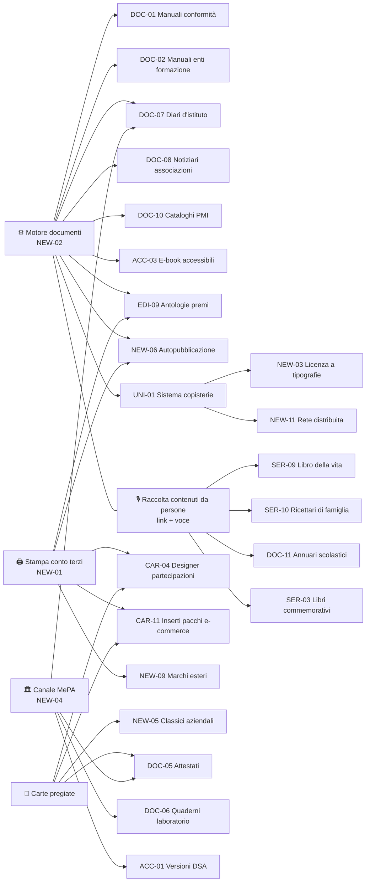

# 03 · Sinergie e orizzontalità

[← Indice](00-indice.md) · [Classifica](02-classifica.md)

*Versione 3 · 16 ottobre 2026 · portafoglio rifatto sulle risposte del titolare: budget sotto 10.000 €, 1–2 persone, clienti B2B già attivi, MePA e sito già attivi*

L'obiettivo non è scegliere *un'*idea, ma un **portafoglio** che condivida macchine, processi, fornitori e canali.

> **Perché serve un portafoglio:** con il filtro Scala nessuna idea supera da sola i 60.000 € di utile annuo a regime, e solo 7 superano i 30.000 € ([mappa scala/velocità](02-classifica.md#mappa-scala-contro-velocità)). Il "buon profitto" arriva sommando **4–6 idee che usano lo stesso motore**, così il costo di avvio di ognuna resta basso.

---

## I cinque motori comuni

| Motore | Cosa si costruisce una volta | Idee che lo riusano | Idee in fascia S o A (v3) |
|---|---|---|---|
| ⚙️ **Motore documenti** ([NEW-02](idee/90-nuove-idee.md)) | Contenuti del cliente → AI → modello → bozza → approvazione → stampa → aggiornamento | DOC-01, 02, 05, 07, 08, 10, 12 · SER-01, 02 · ACC-01, 03 · EDI-09 · UNI-01 · NEW-06 | **10** |
| 🎙️ **Raccolta contenuti da persone** | Link condiviso o telefonata, raccolta di testi, foto e voce da più persone, impaginazione automatica | SER-09, SER-10, DOC-11, SER-03 | 4 |
| 🖨️ **Stampa conto terzi** ([NEW-01](idee/90-nuove-idee.md)) | Portale ordini, listino automatico, controllo file, spedizione con il marchio del cliente | CAR-04, CAR-11, GIO-02, GIO-03, EDI-09, NEW-06, EXP-01, NEW-09, DOC-13 | 4 |
| 📜 **Carte pregiate** | Accordi con i fornitori, campionario, stampa a caldo, rilegatura di pregio | CAR-04, 05, 08, 09, 11 · NEW-05 · DOC-05 · EDI-04 · EXP-02 · NEW-09 | 3 |
| 🏛️ **Canale MePA** ([NEW-04](idee/90-nuove-idee.md)) | Abilitazione (già fatta) e catalogo | DOC-05, 06, 07, 09 · ACC-01, 02 · NEW-08, 12 · EDI-08 | 4 |

**Lettura:** il motore documenti sostiene 10 delle 22 idee in fascia S e A. Con il budget disponibile va costruito **leggero**, sul sito WooCommerce che c'è già, a partire dal primo settore che paga (enti di formazione o notiziari).

---

## Calendario: chi lavora quando le tesi calano

*Aggiornato con il questionario: mesi pieni marzo, luglio, ottobre; agosto con 2 settimane di chiusura.* Il calendario dettagliato mese per mese è in [studi di mercato · 16](../studi-di-mercato/01-contesto/16-calendario-portafoglio.md).

| Gruppo | Idee in fascia S o A (v3) | Quando lavorano |
|---|---|---|
| 🟡 **Senza conflitti** (PIC 5, fascia S o A) | ACC-03 e-book accessibili · NEW-02 motore · UNI-01 sistema copisterie | Non usano le macchine |
| **Senza macchine o quasi** | ACC-03, DOC-01, NEW-06 (servizio), SER-09 (vendita in autunno, libri distribuiti nell'anno) | Tutto l'anno |
| **Mesi pieni secondo il questionario** | Solo **marzo, luglio e ottobre**: novembre e dicembre risultano liberi, quindi le idee natalizie (NEW-05, CAR-08) non sono più penalizzate come prima | Evitare picchi in quei tre mesi |

| Periodo | Tesi | Idee che riempiono senza sovrapporsi |
|---|---|---|
| **Gen** | ○ | DOC-06, DOC-02, CAR-04 (ordini matrimoni), DOC-07 (vendita alle scuole) |
| **Feb – Mar** | ○ / ● | Febbraio libero; a marzo solo servizi senza macchine: ACC-03, DOC-01, NEW-06 |
| **Apr – Mag** | ○ | NEW-01, CAR-04, SER-01, DOC-08, EDI-09 (premi di primavera), UNI-02 (sponsor) |
| **Giu – Lug** | ○ / ● | Giugno libero; luglio solo servizi; DOC-07 inizia la produzione a fine giugno |
| **Ago** | — | **DOC-07** (produzione diari), **UNI-02** (stampa agende), NEW-01 (uscite d'autunno), NEW-12, interni pronti per NEW-05 |
| **Set** | ○ | Consegna diari e agende, DOC-06, NEW-12 |
| **Ott – Dic** | ● / ○ | Ottobre pieno; novembre–dicembre liberi: attestati DOC-05, ordini MePA di fine bilancio, CAR-08 e NEW-05 con tetto |

---

## Ipotesi di portafoglio, versione 3

Costruita sui vincoli emersi dal [questionario](06-risposte-e-ricalibrazione.md): **budget sotto 10.000 €, solo mezzi propri, 1–2 persone**, preferenza per aziende ed enti, clienti istituzionali già attivi, MePA e sito già pronti.

| Strato | Ruolo | Idee | Quando | Investimento indicativo |
|---|---|---|---|---|
| **0. Canale pronto** | Vendere subito ai clienti pubblici | NEW-04: caricare sul MePA attestati (DOC-05), quaderni di laboratorio (DOC-06), stampa e rilegatura | Subito | Quasi zero |
| **1. Clienti che avete già** | Vendere di più a enti di formazione, università, comuni | DOC-02 manuali per gli enti di formazione · DOC-05 attestati di pregio (novembre–dicembre sono liberi) | Ottobre – dicembre 2026 | 1.000–2.500 € |
| **2. Contratti annuali** | Ricavi che si ripetono | DOC-08 notiziari di associazioni e ordini · DOC-07 diari d'istituto (vendita gennaio–aprile, produzione in estate) | Gennaio – aprile 2027 | 1.500–4.000 € |
| **3. Servizi editoriali senza macchine** | Lavorare nei mesi pieni senza usare le macchine | DOC-01 manuali di conformità (con un partner tecnico) · ACC-03 e-book accessibili (competenza da costruire) · NEW-06 autopubblicazione | Da febbraio 2027, uno alla volta | 1.000–4.000 € |
| **4. Riempire agosto** | Usare le macchine quando le tesi calano | UNI-02 agende con sponsor (vendita in primavera, stampa ad agosto) · NEW-01 stampa su richiesta sul sito esistente | Primavera – estate 2027 | 0–3.000 € |
| **Più avanti** | Piattaforma per gli anni 2–5 | NEW-02 in versione leggera → UNI-01 per altre copisterie | Dal 2028, se il primo anno va | Fuori budget oggi |

**Somma indicativa del primo anno:** 5.000–10.000 €, cioè tutto il budget. Per questo gli strati vanno avviati **uno dopo l'altro**, finanziando ciascuno con quanto ha reso il precedente, e ognuno va fermato se non supera il suo criterio di stop (scritto nella scheda).

**Cosa cambia rispetto alla versione 2**
- **Escono** SER-09 come leva di Natale (investimento troppo alto per il budget) e NEW-02 come primo passo (va fatto leggero e più avanti).
- **Entrano** DOC-02 e DOC-05, perché i clienti ci sono già e novembre–dicembre risultano liberi.
- **Restano in panchina** CAR-04 e CAR-11 (A, interesse «Forse»): da riprendere se il titolare li trova interessanti dopo un approfondimento.

**Una tensione da sciogliere:** il titolare preferisce «progetti sempre diversi», mentre il portafoglio è fatto quasi solo di lavori ricorrenti. Le idee più vicine a quella preferenza sono DOC-01 (ogni prodotto è un progetto nuovo), NEW-06 (ogni libro è diverso) e, fuori dalle prime, DOC-03 e SER-08. Si può bilanciare tenendo uno strato di progetti accanto ai ricorrenti, che pagano le spese fisse.

---

## Domande ancora aperte

1. Le sei incongruenze in [06](06-risposte-e-ricalibrazione.md#2-incongruenze-da-chiarire), in particolare: macchine presenti e area ZLS.
2. Quali clienti attuali (enti di formazione, università, comuni) sono i primi da contattare, con volumi indicativi.
3. Quanto pesare la preferenza per progetti sempre diversi.
